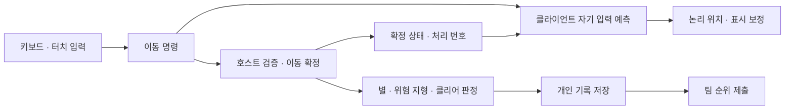

# 우왕좌왕 미로: 2인·4인 협동

> 방향키를 나눠 맡고 하나의 캐릭터를 함께 움직이는 Unity 기반 온라인 협동 미로 게임입니다.

[Google Play에서 보기](https://play.google.com/store/apps/details?id=com.parkwonkuk.kungjakjak) · [아키텍처](docs/architecture.md) · [문제 해결 사례](docs/case-studies.md)

## 프로젝트 개요

2인 플레이에서는 한 명당 두 방향, 4인 플레이에서는 한 명당 한 방향을 무작위로 배정받습니다. 각자 맡은 방향을 입력해 장애물을 피하고 별을 수집한 뒤 목표 지점에 도달합니다. 서로의 입력이 한 캐릭터에 합쳐지므로 타이밍과 의사소통이 핵심입니다.

| 항목 | 내용 |
|---|---|
| 게임명 | 우왕좌왕 미로: 2인·4인 협동 |
| 개발 형태 | 1인 개발 — 기획, 클라이언트, 온라인 기능, UI, Android 배포 담당 |
| 개발 기간 | 2026년 5월부터 개발 및 업데이트 진행 |
| 플랫폼·출시 | Android · Google Play 출시 |
| 엔진·언어 | Unity 6000.3.6f1 · C# · URP |
| 네트워크 | Netcode for GameObjects 2.11.2 · Unity Transport 2.7.3 |
| 온라인 서비스 | Unity Authentication · Lobby · Relay · Cloud Save · Leaderboards |

이 저장소는 게임의 설계와 문제 해결 과정을 소개하는 공개 기술 포트폴리오입니다. 전체 게임 소스와 실행 파일은 포함하지 않습니다.

**문서 기준: 2026-10-22의 현재 개발 프로젝트.** 출시된 게임의 소개와 현재 코드의 기술 설명을 함께 제공합니다. Google Play 배포본과 개발 중인 업데이트의 기능은 다를 수 있습니다.

## 핵심 게임플레이

1. 2명 또는 4명이 온라인 방에 참가합니다.
2. 이동 방향을 무작위로 나누어 맡습니다.
3. 키보드 또는 모바일 터치로 하나의 캐릭터를 협동 조작합니다.
4. 장애물과 위험 요소를 피하고 별을 수집해 목표 지점에 도달합니다.
5. 맵·플레이 인원별 개인 기록과 팀 순위를 확인합니다.

## 주요 구현

| 주제 | 현재 프로젝트의 구현 |
|---|---|
| 입력 검증 | 호스트가 참가자·배정 키·명령 순서·라운드 식별자·이동 가능 상태를 확인 |
| 입력 예측 | 자신의 입력을 호스트 응답 전에 적용하고, 확정 상태에서 미처리 입력을 재계산 |
| 제한적 되감기 | 짧게 늦은 입력을 이동 이력에 반영하되, 이미 발생한 별·위험 지형·골 판정 경계를 보호 |
| 화면 보정 | 논리 위치와 표시 위치를 분리해 이동 결과와 화면 보정의 책임을 구분 |
| 세션 관리 | 앱·세션·씬 수명 분리, 방 생성·참가 시 세션 생성, 종료 시 구독·주기 작업 정리 |
| 이탈 처리 | 게임 중 누구든 이탈하면 세션 종료와 로비 복귀, 대기방에서는 참가자 이탈 시 호스트가 방 유지 |
| 기록 저장 | Cloud Save 개인 기록과 Leaderboards 제출의 결과를 분리 |
| 지연 진단 | 입력·로컬 적용·화면 반영·호스트 확정 시점과 RTT를 구분하고 로그 파일 저장 |
| 모바일 서비스 | 익명 인증, AdMob 광고·UMP 동의, 사운드 설정과 개인정보처리방침 안내 |

### 현재 업데이트 작업

Google Play Games 계정 연결·해제와 기존 계정 복구 흐름을 구현 중입니다. 익명 계정 연결 시 기존 Unity 플레이어 ID를 유지하고, 복구 로그인은 새 계정을 생성하지 않는 방식으로 구성했습니다. 이 항목은 배포 완료나 모든 실기기 시나리오 검증을 의미하지 않습니다.

## 기술 구조

- [아키텍처](docs/architecture.md): 책임 경계, 실제 호출 흐름과 수명 관리
- [문제 해결 사례](docs/case-studies.md): 입력 예측·되감기, 이탈 정책, 저장 실패 처리와 진단

## 구현 확인 범위

기술 설명은 현재 코드의 정적 확인을 기준으로 작성했습니다. 입력 지연 감소율, 동시 접속 규모, 모든 기기에서의 안정성 등 측정하지 않은 수치는 제시하지 않습니다. 코드 수준 검사와 Unity Play Mode·Android 실기기·다인 접속 검증은 별도로 구분합니다.
