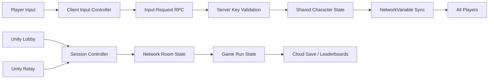

# WASD2 — Shared-Input Online Co-op

> 2명 또는 4명의 플레이어가 W·A·S·D 입력을 나눠 하나의 캐릭터를 함께 조작하는 Unity 기반 온라인 협동 게임입니다.

[아키텍처](docs/architecture.md) · [문제 해결 사례](docs/case-studies.md)

## 프로젝트 개요

플레이어마다 이동 키가 무작위로 배정됩니다. 2인 플레이에서는 한 명당 두 개의 키를, 4인 플레이에서는 한 명당 하나의 키를 담당합니다. 서로의 입력을 맞춰 장애물을 피하고 별을 수집한 뒤 목표 지점에 도달해야 합니다.

- **엔진:** Unity 6000.3.6f1, URP 17.3
- **언어:** C#
- **플랫폼:** Android
- **프로젝트 형태:** 개인 프로젝트
- **개발 기록:** 30개 커밋, 8개 Pull Request 병합
- **핵심 기술:** Netcode for GameObjects, Lobby, Relay, Cloud Save, Leaderboards

## 출시 정보

- **출시 플랫폼:** Android
- **상태:** 출시 준비 중

상용 출시를 준비 중인 프로젝트이므로 실행 파일과 전체 소스 코드는 공개하지 않습니다. 이 저장소는 게임의 핵심 아이디어, 기술적 의사결정, 문제 해결 과정과 플레이 화면을 소개하는 채용 포트폴리오입니다.

## 핵심 게임플레이

1. 2명 또는 4명의 플레이어가 온라인 방에 참가합니다.
2. W·A·S·D 키가 플레이어 수에 맞춰 무작위로 분배됩니다.
3. 각자 맡은 방향을 입력해 하나의 캐릭터를 협동 조작합니다.
4. 장애물과 위험 요소를 피하고 별을 수집해 목표 지점에 도달합니다.
5. 클리어 시간과 충돌 횟수를 기준으로 기록을 저장하고 순위를 비교합니다.

## 게임 화면

플레이 영상과 스크린샷은 공개 가능한 출시 준비 빌드를 기준으로 추가할 예정입니다.

## 주요 시스템

| 시스템 | 구현 내용 |
|---|---|
| 온라인 세션 | Unity Lobby 검색·생성, Relay 참가 코드, Host/Client 연결과 세션 종료 처리 |
| 공유 입력 | 2인 플레이 시 2키, 4인 플레이 시 1키를 무작위 배정 |
| 권한 검증 | 클라이언트 입력을 서버에서 담당 키와 대조한 뒤 이동 상태 반영 |
| 상태 동기화 | 서버 권한형 캐릭터 위치·방향·이동 가능 상태와 게임 진행 상태 동기화 |
| 룸 시스템 | 참가자·닉네임·선택 맵·배정 키를 NetworkList와 NetworkVariable로 공유 |
| 게임 진행 | 별 수집, 충돌 집계, 클리어 판정, 재시작과 로비 복귀 |
| 기록 시스템 | Cloud Save 기반 개인 최고 기록, Leaderboards 기반 플레이 인원·맵별 순위 |
| 맵 시스템 | 경로·루프·장애물·시작점·도착점을 구성하는 절차적 맵 생성 |
| 모바일 대응 | 터치 방향 입력, 전체 화면 처리, 연결 오류 재시도 UI와 AdMob 연동 |
| 오디오 | 씬 전환에도 유지되는 배경음·효과음 설정 |

## 담당 영역

개인 프로젝트로 게임 기획부터 클라이언트와 온라인 시스템까지 전체 개발을 담당했습니다.

### 멀티플레이와 세션

- Unity Authentication 익명 로그인과 서비스 초기화
- Lobby 생성·검색, Relay 할당과 참가 코드 연결
- Host heartbeat와 방 상태 관리
- Host 이탈·참가자 연결 해제·네트워크 오류 예외 처리

### 공유 캐릭터 조작

- 플레이 인원에 따른 W·A·S·D 키 분배
- 클라이언트 입력 요청과 서버 측 권한 검증
- 서버 권한형 위치·방향·이동 상태 동기화
- 키보드와 모바일 터치 입력의 동일한 입력 경로 구성

### 게임과 데이터 시스템

- 별 수집, 충돌, 클리어 시간 동기화
- 맵·인원별 기록 저장과 팀 단위 리더보드 표시
- 닉네임과 개인 최고 기록 Cloud Save 연동
- 맵 선택, 룸, 게임 결과, 랭킹 UI 구현

## 기술적 설계

자세한 구조와 선택 이유는 [아키텍처 문서](docs/architecture.md), 구현 중 해결한 문제는 [문제 해결 사례](docs/case-studies.md)에서 확인할 수 있습니다.

## 사용 기술

- **Engine & Rendering:** Unity 6.3, URP, 2D Tilemap
- **Networking:** Netcode for GameObjects, Unity Transport, Lobby, Relay
- **Backend:** Unity Authentication, Cloud Save, Leaderboards
- **Input & Platform:** Input System, Android touch controls
- **Monetization:** Google Mobile Ads
- **Collaboration:** Git, GitHub branches, pull requests
