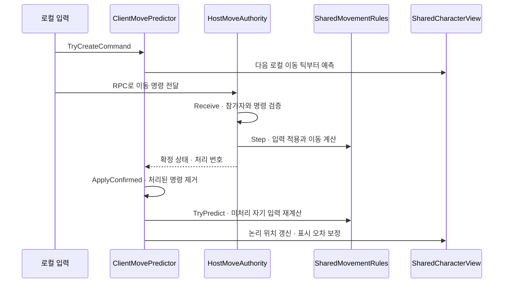

# 우왕좌왕 미로: 2인·4인 협동 — 아키텍처

기준: 2026-10-22 현재 개발 코드. [게임 소개](../README.md) · [문제 해결 사례](case-studies.md)

## 설계 목표

여러 플레이어의 입력을 하나의 캐릭터에 합치면서 입력 반응, 호스트의 최종 판정, 세션 종료와 기록 저장의 기준을 일관되게 유지합니다.

- 2인은 각 2방향, 4인은 각 1방향 담당
- 클라이언트는 자신의 입력을 예측하고 호스트는 최종 이동을 확정
- 이동 계산과 별·위험 지형·클리어의 부수 효과 분리
- 앱·세션·씬의 수명을 구분
- 개인 기록 저장과 순위 제출의 실패 분리

## 책임과 수명

| 구분 | 주요 구성 | 역할 |
|---|---|---|
| Domain | 키 배정 정책, 공유 이동 규칙, 기록 비교 정책 | Unity 서비스와 분리된 게임 규칙 |
| Application | 이동 권한·예측, 방·세션·프로필·기록 UseCase, Port | 작업 순서와 실패·종료 정책 |
| Infrastructure | UGS·Relay·NGO·Cloud Save 어댑터 | 외부 SDK와 Port 연결 |
| Presentation | ViewModel, View, 공유 캐릭터 표시 | 입력 전달과 상태 표시 |
| Bootstrap | AppCompositionRoot, AppScope, SceneEntryPoint | 의존성 조립과 수명 연결 |

`AppCompositionRoot`가 앱 수명 객체를 생성합니다. 온라인 세션 의존성은 생성 방법만 등록하고, `SessionLifetime.Begin`에서 필요한 시점에 만듭니다. `SessionScope.Dispose`는 취소 토큰, 구독과 주기 작업을 정리합니다. 씬 전용 연결은 각 `SceneEntryPoint`에서 담당합니다.

Lobby는 방 검색과 메타데이터, Relay는 연결 경로, Netcode for GameObjects는 참가자 연결과 상태 전달을 담당합니다.

## 입력에서 확정까지

### 호스트 판정

`HostMoveAuthority.Receive`에서 참가자, 순서 번호, 라운드 식별자(Epoch), 담당 키와 이동 상태를 확인합니다. 호스트 자신의 입력도 같은 경로를 거칩니다. `Step`은 적용 틱 순으로 명령을 처리하며 같은 틱에서는 수신 순서를 사용합니다.

### 클라이언트 예측

`ClientMovePredictor`는 명령을 보관하고 다음 로컬 이동 틱부터 반영합니다. 확정 상태를 받으면 오래된 상태를 무시하고, 처리 번호에 포함된 명령을 제거합니다. 이어서 확정 상태부터 아직 처리되지 않은 자기 명령만 재적용합니다. 대기 명령과 예측 거리에는 한도를 둡니다.

### 제한적 되감기

호스트는 짧게 늦게 도착한 입력에 대해 이동 이력과 모든 플레이어의 명령을 다시 계산합니다. 설정상 최대 0.2초 구간을 요청하며 내부적으로 최대 32틱으로 제한합니다.

이미 외부에 전달한 별·위험 지형·골 판정 이전으로는 되감지 않습니다. 재계산 중 과거에 새로운 판정 접촉이 생기면 되감기를 취소하고 현재 틱에 입력을 적용합니다. 게임 판정을 취소·재발행하는 범용 롤백 시스템은 아닙니다.

### 논리 상태와 표시

`SharedMovementRules`가 공통 이동 규칙을 담당하고 충돌 조회는 인터페이스로 전달받습니다. `SharedCharacterView`는 논리 루트와 VisualRoot를 구분해 확정 상태 보정과 화면 표시를 처리합니다. 현재 캐릭터 이동은 Rigidbody2D 보간에 의존하지 않습니다.

## 게임 진행과 이탈

별 수집·위험 지형·클리어 등 최종 게임 판정은 호스트 측 흐름에서 처리합니다. 클라이언트 예측은 이러한 부수 효과를 실행하지 않습니다.

`HandlePlayerDisconnectedUseCase`의 정책:

| 상황 | 처리 |
|---|---|
| 게임 중 어느 참가자든 이탈 | 세션 종료, 로비 복귀 |
| 대기방에서 참가자 이탈 | 호스트는 방 유지 |
| 대기방에서 호스트 이탈 | 참가자는 로비 복귀 |

종료 처리는 `LeaveSessionUseCase`와 세션 수명 관리로 연결됩니다.

## 프로필·기록·계정

`SubmitRunRecordUseCase.ExecuteAsync`는 다음 순서로 실행합니다.

1. 기록 조건 확인
2. 서비스 초기화·인증 보장
3. 현재 프로필 저장
4. Cloud Save 개인 기록 저장
5. Leaderboards 제출

초기화·프로필·개인 기록 저장이 실패하면 뒤의 제출을 진행하지 않습니다. 리더보드가 실패 결과를 반환해도 이미 저장된 개인 기록 결과는 유지합니다. 두 외부 서비스가 하나의 원자적 트랜잭션을 이루는 것은 아닙니다.

계정 연결·해제와 복구는 현재 업데이트 작업입니다. 기존 익명 플레이어 ID에 Google Play Games 인증을 연결하며, 복구 시에는 새 계정 생성을 금지하는 조건을 사용합니다. 배포본과 실기기 검증 범위는 별도로 확인해야 합니다.

## 진단

- `MoveInputLatencyTrace`: 입력·로컬 적용·화면 반영·호스트 확정 구간
- `RelayLatencyDiagnostics`: 애플리케이션 RTT와 Transport RTT 등 연결 진단
- `UnityTextLogWriter`: 실행 로그의 텍스트 파일 저장

RTT와 화면 반영 시간은 서로 다른 지표이며, 이 문서는 측정되지 않은 성능 개선 수치를 주장하지 않습니다.
