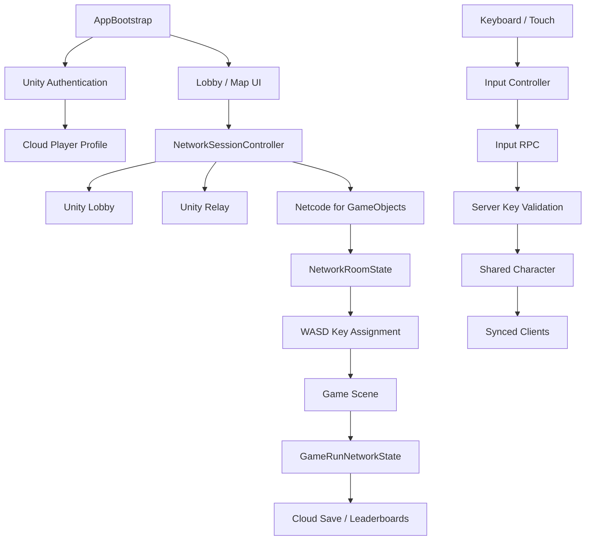
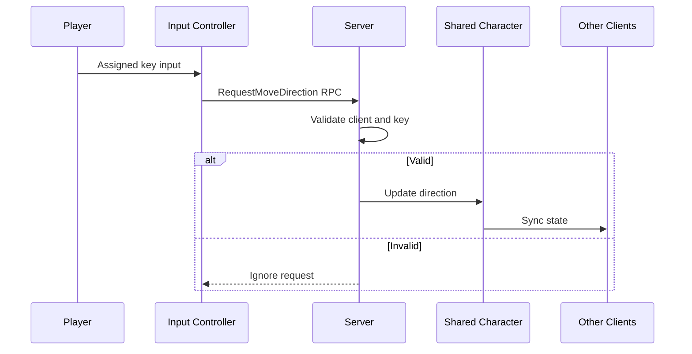

# 아키텍처

## 설계 목표

WASD2의 핵심 과제는 여러 플레이어의 입력을 하나의 캐릭터 상태로 안전하게 합치면서, 방 생성부터 게임 결과 저장까지 온라인 흐름을 일관되게 유지하는 것입니다.

- 2인·4인 플레이에 따라 입력 권한을 동적으로 분배
- 클라이언트의 임의 방향 요청을 서버에서 검증
- Lobby, Relay, Netcode 세션의 생명주기 통합
- 모든 참가자에게 동일한 게임 진행 상태 제공
- 개인 최고 기록과 팀 순위를 중복 없이 저장

## 전체 구조

## 세션 계층

`AppBootstrap`은 인터넷 연결, Unity Services, 익명 인증과 프로필 로딩을 처리합니다. 실패하면 재시도 가능한 오류 UI를 표시합니다.

`NetworkSessionController`는 다음 책임을 갖습니다.

- Lobby 생성·검색과 선택 맵 메타데이터 관리
- Relay Allocation과 Join Code 연결
- Unity Transport의 Host·Client 설정
- Host heartbeat와 방 상태 관리
- Host·Client 종료 시 Lobby 정리
- Host 이탈과 연결 해제 후 로비 복귀
- 배정 키와 닉네임을 씬 전환 사이에 보존

Lobby는 방 검색을, Relay는 연결 경로를, Netcode for GameObjects는 게임 상태 동기화를 담당합니다.

## 룸과 입력 권한

`NetworkRoomState`는 참가자, 닉네임, 선택 맵과 배정 키를 관리합니다.

- 2명: 한 명당 2개의 이동 키
- 4명: 한 명당 1개의 이동 키
- Host만 키 배정과 게임 시작 가능
- 모든 참가자에게 같은 배정 결과 전달

클라이언트가 로컬 배정 키를 먼저 확인하고, 서버가 Client ID와 배정 키를 다시 대조해 최종 권한을 보장합니다.

## 서버 권한형 이동

`SharedCharacterController`는 서버가 이동 결과를 결정합니다. 위치, 방향, 이동 가능 여부와 버전을 `ServerMoveState`로 발행합니다. 방향 변경과 정지는 즉시 공유하고, 이동 위치는 일정 거리 이상 변했을 때 갱신해 트래픽과 반응성의 균형을 맞췄습니다.

## 게임 진행 상태

`GameRunNetworkState`는 수집한 별, 클리어 여부와 시간, 충돌 횟수, run ID와 서버 기준 시작 시각을 서버 쓰기 권한으로 관리합니다. 모든 참가자가 같은 결과를 확인하며 Host가 저장과 랭킹 제출을 대표로 수행합니다.

## 저장과 랭킹

- **Cloud Save:** 맵·인원 조합별 개인 최고 기록
- **Leaderboards:** 클리어 시간과 충돌 횟수를 반영한 팀 순위
- **Metadata:** 닉네임, 팀원, 맵, 인원, 기록과 run ID
- **중복 제거:** 하나의 협동 플레이를 run ID 기준으로 한 번만 표시

UI, 세션, 룸, 게임 진행과 저장 책임을 분리해 씬 전환과 온라인 예외 상황에서도 각 상태의 수명을 명확하게 유지했습니다.
